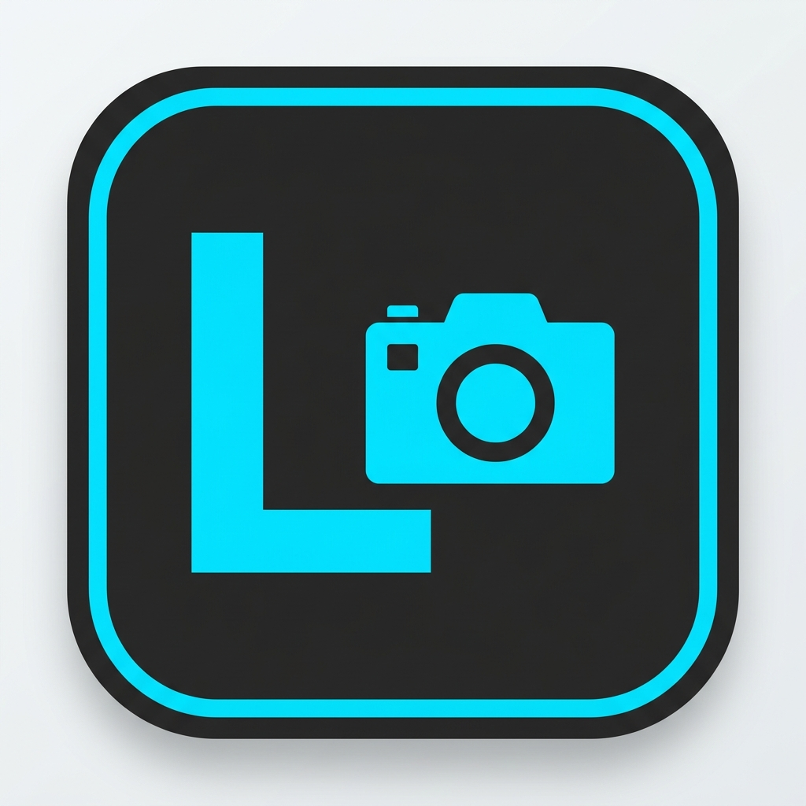

# Lumify — Pro RAW & Photo Editor for Android

<p align="center">
  
</p>

<p align="center">
  <a href="https://kotlinlang.org"></a>
  <a href="https://developer.android.com/build"></a>
  <a href="https://developer.android.com/jetpack/compose"></a>
  
  
</p>

**Lumify** is a professional, hardware-accelerated mobile photo and RAW editor built natively in **Kotlin** and **Jetpack Compose**. It features a non-destructive 32-bit floating-point color pipeline, full support for camera RAW sensor formats, 8-channel HSL color grading, real-time RGB histograms, and an Adobe-inspired **Liquid Glass UI**.

---

## Key Features

### 1. Comprehensive RAW & Image Decoder
- **Universal RAW Support:** Decodes and edits Adobe Digital Negative (`.dng`), Canon (`.cr2`, `.cr3`), Nikon (`.nef`), Sony (`.arw`), Olympus (`.orf`), Panasonic (`.rw2`), Pentax (`.pef`), and Fujifilm (`.raf`).
- **Standard Raster Formats:** Full high-fidelity support for `.jpg`, `.jpeg`, `.png`, `.webp`, `.heic`, and `.bmp`.
- **Auto EXIF Orientation:** Corrects camera sensor orientation (`ORIENTATION_ROTATE_90`, `180`, `270`, flip) on load.
- **EXIF Metadata Preservation:** Displays and retains camera make, model, lens, focal length, aperture, shutter speed, and ISO upon export.

### 2. Studio Tone & Exposure Engine
- **Exposure:** Linear sensor exposure adjustment with $\pm 2.0$ EV dynamic range.
- **Contrast & S-Curve:** High-dynamic range contrast centered around 18% middle gray.
- **Shadows & Highlights:** Selective shadow lift and blown-out highlight recovery without clipping midtones.
- **Whites & Blacks:** Dedicated white point and black point clipping sliders.
- **Kelvin White Balance:** Physical temperature shift (Cool Blue $\leftrightarrow$ Warm Amber) and Tint balance (Green $\leftrightarrow$ Magenta).
- **Vibrance vs. Saturation:** Smart vibrance boosting muted tones while preventing oversaturation of human skin tones.

### 3. 8-Channel HSL Color Grading
Independently manipulate **Hue Shift**, **Saturation**, and **Luminance** across 8 distinct color channels:
- **Red** (Lipstick, sunset accents, floral reds)
- **Orange** (Skin tones, warm golden sunlight)
- **Yellow** (Autumn foliage, interior warm lights)
- **Green** (Nature, vegetation, landscapes)
- **Cyan** (Tropical ocean water, sky transitions)
- **Blue** (Sky, denim, deep water bodies)
- **Purple** (Twilight skies, violet florals)
- **Magenta** (Neon highlights, creative color splits)

### 4. Detail, Optics & Sharpness
- **3x3 Unsharp Mask Convolution:** Texture and micro-contrast enhancement without halo artifacts.
- **Clarity:** Midtone contrast optimization for punchy architectural and portrait details.
- **Vignette:** Smooth radial falloff with customizable edge darkening.

### 5. Geometry & Crop
- **Preset Ratios:** 1:1 (Square), 4:5 (Instagram Portrait), 16:9 (Landscape), 9:16 (Story/Reel), 3:2 (35mm Film), 4:3 (Standard).
- **Interactive Rule-of-Thirds Grid:** Visual alignment grid with corner and edge drag handles.
- **Spatial Transforms:** 90-degree clockwise rotations, horizontal flipping, and fine $\pm 45^\circ$ angle leveling.

### 6. Cinematic Presets
Built-in instant grading profiles:
- **RAW Neutral:** Clean, uncompressed baseline with balanced shadows.
- **Golden Hour:** Rich sunset warmth with golden yellow-orange highlights.
- **Teal & Orange:** Modern cinematic blockbuster look with cyan shadows and warm skin tones.
- **Moody Film:** Matte faded blacks, desaturated foliage, and analog character.
- **Silver B&W:** High-dynamic range black-and-white with punchy silver tones.
- **Cyberpunk:** Electric cyan and magenta glow for night cityscapes.
- **HDR Pop:** Maximum dynamic range recovery for landscapes.

### 7. Non-Destructive Workflow & Liquid Glass UI
- **Infinite Undo / Redo:** Full revision history stack.
- **Split Comparison View:** Interactive Before/After comparison slider or hold-to-compare overlay.
- **Live RGB & Luminance Histogram:** Real-time 60 FPS histogram calculation.
- **Liquid Glass Aesthetics:** Frosted glass bottom controls with directional specular rim lighting and tactile haptic sliders.

---

## Project Structure

```
Lumify/
├── app/
│   ├── src/
│   │   ├── main/
│   │   │   ├── java/com/lumify/editor/
│   │   │   │   ├── MainActivity.kt               # Edge-to-edge container & intent handling
│   │   │   │   ├── camera/
│   │   │   │   │   └── CameraManager.kt          # CameraX photo capture
│   │   │   │   ├── core/
│   │   │   │   │   ├── EditState.kt              # Immutable state & Undo/Redo stack
│   │   │   │   │   ├── ImageProcessor.kt         # Tone, HSL, Sharpness, Histogram engine
│   │   │   │   │   └── RawImageDecoder.kt        # Multi-format RAW/JPG decoder with EXIF
│   │   │   │   ├── presets/
│   │   │   │   │   └── FilterPreset.kt           # Cinematic preset profiles
│   │   │   │   └── ui/
│   │   │   │       ├── components/
│   │   │   │       │   ├── AdjustSlider.kt       # Double-tap reset tactile slider
│   │   │   │       │   ├── CropOverlay.kt        # Rule-of-thirds grid crop overlay
│   │   │   │       │   ├── HistogramView.kt      # Real-time RGB histogram canvas
│   │   │   │       │   ├── LiquidGlass.kt        # Glassmorphic surfaces & buttons
│   │   │   │       │   ├── LumifyLogo.kt         # Adobe-style squircle brand logo
│   │   │   │       │   └── SplitComparisonView.kt# Interactive Before/After comparison
│   │   │   │       ├── screens/
│   │   │   │       │   ├── EditorScreen.kt       # Main editing studio interface
│   │   │   │       │   ├── EditorViewModel.kt    # Async pipeline & state management
│   │   │   │       │   ├── ExportDialog.kt       # Multi-format export dialog (JPG/PNG/WEBP)
│   │   │   │       │   └── HomeScreen.kt         # Import, camera & sample photo hub
│   │   │   │       └── theme/
│   │   │   │           ├── Color.kt              # Dark OLED palette & HSL channel swatches
│   │   │   │           ├── Theme.kt              # Material 3 & status bar coordination
│   │   │   │           └── Type.kt               # Modern typography scale
│   │   │   └── res/                              # Vector icons (SVG), launcher icons, and themes
│   │   └── test/java/com/lumify/editor/          # Unit tests
│   └── build.gradle.kts                          # App dependencies & Kotlin 2.x setup
├── gradle/
│   ├── libs.versions.toml                        # Centralized dependency catalog
│   └── wrapper/                                  # Gradle wrapper configuration
├── build.gradle.kts                              # Root project configuration
└── settings.gradle.kts                           # Module settings
```

---

## Professional Recommendations for Next-Level Capability

To evolve Lumify into a desktop-caliber mobile editing suite like Adobe Lightroom Mobile or Capture One, the following next additions are recommended:

1. **Interactive Tone Curves (RGB & Parametric):**
   - Implement interactive cubic spline tone curves for Luminance, Red, Green, and Blue channels with draggable anchor points for precise shadow, midtone, and highlight control.

2. **Local Masking & Selective Adjustments:**
   - Add Brush, Linear Gradient, and Radial Gradient masks allowing users to adjust exposure, clarity, and saturation on specific regions of a photo (e.g. dodging faces or burning skies).

3. **White Balance Eyedropper (Pipette Tool):**
   - Allow users to tap anywhere on a neutral gray or white area in the photo to automatically calculate and balance temperature and tint offsets.

4. **Lens Profile Correction & Defringe:**
   - Automatic chromatic aberration correction (purple/green fringe removal) and barrel/pincushion optical distortion correction based on EXIF lens metadata.

5. **Batch Processing & Preset Sharing:**
   - Copy edit settings from one photo and paste them across an entire shoot, plus import/export `.xmp` or `.cube` 3D LUT lookup tables.

---

## Getting Started

### Prerequisites
- **Android Studio Ladybug (2024.2+)** or newer.
- **JDK 21** (Adoptium / Corretto / Oracle).
- Android device or emulator running **Android 8.0 (API 26)** or higher (Targeting Android 15 / API 35).

### Build & Run
1. Open **Android Studio** and choose **Open an Existing Project**, selecting the `Lumify` folder.
2. Allow Gradle to synchronize dependencies automatically.
3. Connect an Android device or start an emulator.
4. Click **Run** (`Shift + F10`) or execute in terminal:
   ```bash
   ./gradlew installDebug
   ```

---

## License
Lumify is distributed under the MIT License.
